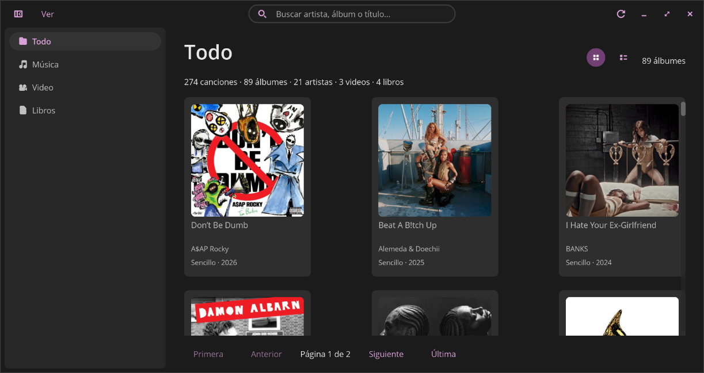

# Mediateca Local

A local media catalog for the COSMIC desktop. Point it at a folder and browse your music, videos and books in one place. It only reads your files, never touches them.



- **Read-only:** never writes to, moves or renames anything in your collection.
- **Fully offline:** no network requests, no update checks, no telemetry — the About dialog's only link opens your system browser; the app itself never connects.
- **Native COSMIC look**, built with libcosmic.
- **Opens items in your default app.**

> **Status:** early release (v0.2.0). Tested on Pop!_OS with the COSMIC desktop, using a real library of a few hundred files. Pagination for large libraries exists only in the "All" view so far (see Known limitations).

## Quick start

1. Install it (see below).
2. Open Mediateca Local and choose your media folder.
3. Wait for the first scan. It can take a while on large libraries, and there is no progress display yet.
4. Browse by artist, album, series or author. Click an item to open it.

## Install

Build from source:

```sh
git clone https://github.com/xoloitzcuintle95/mediateca-local.git
cd mediateca-local
just run        # build and run
just install    # install to ~/.local
```

You need:

- GNU/Linux with the [COSMIC](https://github.com/pop-os/cosmic-epoch) libraries
- Rust >= 1.93 (via [rustup](https://rustup.rs/); the pinned libcosmic revision requires it)
- [just](https://github.com/casey/just)
- A C compiler (`build-essential` on Pop!_OS/Ubuntu), needed to build `mimalloc`

Other system libraries may be needed depending on your distro. If the build fails, please open an issue.

## What it does

It scans one folder, reads tags and embedded covers from your existing files, and groups them: music by artist/album, video by series/season/episode, books by author. Opening an item hands it to your system's default application.

| Kind  | Formats        | Notes                                      |
|-------|----------------|--------------------------------------------|
| Music | mp3, flac, ogg | tags and embedded covers                   |
| Video | mkv, mp4, avi  | identified by file name (SxxEyy); no posters |
| Books | epub, pdf      | epub metadata and covers; pdf listed plainly |

The catalog database lives in `~/.local/share/com.xoloitzcuintle95.MediatecaLocal/` and the cover thumbnails in `~/.cache/com.xoloitzcuintle95.MediatecaLocal/`; the chosen folder is saved in `~/.config/cosmic/com.xoloitzcuintle95.MediatecaLocal/`. Deleting those directories resets the catalog and the cover cache — the app never touches the files in your collection.

## Getting good results

Mediateca Local does not fetch metadata from the internet and does not read NFO files or movie posters. It relies on the tags and file names your files already have. Before importing, it is worth tidying your collection with:

- **Music:** [MusicBrainz Picard](https://picard.musicbrainz.org/) (accurate artist/album/title tags and embedded art)
- **Video:** [tinyMediaManager](https://www.tinyMediaManager.org/) (consistent `Series SxxEyy` file names)
- **Books:** [Calibre](https://calibre-ebook.com/) (proper EPUB metadata)

## Known limitations

- Pagination is implemented in the "All" view only. The Music and Books views still render everything, so very large libraries may feel slow there.
- Not benchmarked with very large libraries yet.
- The first import shows no progress, and can take a while on a spinning disk.
- Search does not normalize accents.
- Books are shown as a flat list; no nested shelves.
- PDFs are catalogued without reading their metadata.
- Video is matched by file name only.
- The details panel misbehaves when the window is very narrow and tall.

## Built with AI assistance

This project was built with the help of AI coding models, and reviewed through tests and daily use. See [AGENTS.md](./AGENTS.md) for the project rules.

<details>
<summary>For developers</summary>

**Tests**

```
cargo test
```

**Contributing.** Issues are welcome. [AGENTS.md](./AGENTS.md) describes the project's rules for anyone (human or AI) working on it.

**Translations.** Fluent files in `i18n/` (en and es).

**Packaging.** For distro packaging, vendor dependencies and build from the vendored sources:

```
just vendor
just build-vendored
just rootdir=/path/to/pkg prefix=/usr install
```

The build script only reads `resources/` and `i18n/` and writes to `target/xdgen/`.

</details>

## License

MIT. See [LICENSE](LICENSE).
